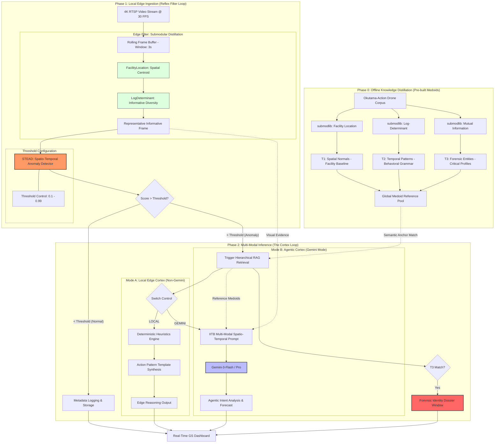

# IIT Bombay: STEAD-Cortex System Architecture & Presentation

## 1. System Architecture Diagram (Mermaid)

---

## 2. Presentation Slides

### Slide 1: The Philosophy of the "Edge Filter"
**Title: Submodular Distillation - Intelligence at Scale**

*   **The Bottleneck:** Processing every frame of 4K drone video (30 FPS) for anomaly detection is computationally bankrupting for edge hardware.
*   **The "Edge Filter" Implementation:** 
    *   **Frame Selection:** We select **exactly 1 "Representative" frame** from a 3-second (90 frame) rolling buffer.
    *   **Selection Pipeline:** 
        1. `FacilityLocation()` picks the cluster centroid (Spatial representative).
        2. `LogDeterminant()` ensures that if multiple centroids exist, we pick the most "informative" one (Information diversity).
*   **Edge Compute Efficiency:** By using **Lazy Greedy Optimization (CELF - Cost-Effective Lazy Forward)**, we reduce complexity from $O(n^2)$ to nearly $O(n)$, allowing these complex set-selection functions to run in real-time on drone hardware (e.g., Jetson Orin).

### Slide 2: Hierarchical 3-Tier RAG Retrieval
**Title: Structured Knowledge Anchoring**

*   **The Mechanism:** When an anomaly is detected, the system retrieves the nearest neighbors from a structured medoid pool.
*   **The Tiers (Submodlib Function Matrix):**
    *   **T1: Spatial Normals (Facility Baseline):** Populated using **`FacilityLocation()`**. Maps geographic/structural "medoids." (Is this geographic feature expected here?)
    *   **T2: Behavioral Grammar (Temporal):** Populated using **`LogDeterminant()`**. Maps diversity of movement/actions. (Is this vehicle trajectory standard?)
    *   **T3: Critical Forensic (Entity):** Populated using **`MutualInformation()`**. Maps forensic identifiers (Face/ID/Signage). (Is this identity authorized?)
*   **Outcome:** This structured context is fed into the reasoning engine, anchoring the AI's response to mathematical baselines.

### Slide 3: Population Strategy - Base vs. Live Memory
**Title: How Memory is Built**

*   **Standardizing "Normal":**
    *   **Base Memory Population:** Performed **Offline**. We ingest massive datasets (e.g., Okutama) and run `submodlib` over 100k+ frames to find the top ~0.1% most representative "Golden Medoids" for T1-T3.
    *   **Live Memory Population:** Performed **Online**. The on-drone `submodlib` filter constantly populates an ephemeral mission buffer. 
*   **The Live Inference Comparison:** 
    1. The **Live Frame** is compared against its own **Live Mission Buffer** (Local Delta).
    2. Then it is compared against the **Base Medoid Pool** (Global Delta).
*   **Synthesis:** If a frame is unique to the mission *and* unique to the base pool, the **STEAD Anomaly Score** spikes, triggering the Cortex.

### Slide 4: T3 Forensic Analysis & Identity Resolution
**Title: Deep Forensic Deep-Dive**

*   **Trigger:** Activated only when a T3-tier match exceeds the similarity threshold or when Gemini identifies a high-priority forensic entity.
*   **Functionality:** Opens a dedicated **Forensic Dossier Window** on the Ground Station.
*   **Identity Resolution:** 
    1. **Feature Extraction:** Uses `MutualInformation()` to prioritize forensic features (e.g., specific markings, uniform types).
    2. **Biometric/OCR Check:** Cross-references with the T3 Base Identity Store.
    3. **History Linkage:** Pulls all past appearances of this entity from the **Live Ephemeral Store**.
*   **Outcome:** Provides a "Probability of Threat" based on known historical behavior of the matched entity.

### Slide 5: Dual-Mode Reasoning Strategy
**Title: Heuristic vs. Agentic Response**

*   **Non-Gemini (Local Edge Cortex):**
    *   **Design:** A "Reflexive" response system. It uses whitelisted risk benchmarks and affected-key templates.
    *   **Advantage:** Deterministic, low-power, and ultra-reliable for air-gapped combat/patrol scenarios.
    *   **Output:** Actionable triggers (e.g., `SECURE_SECTOR`, `INITIATE_TRACKING`).
*   **Gemini Mode (Agentic Cortex):**
    *   **Design:** A "Cognitive" multi-modal synthesis.
    *   **Advantage:** Understands **Intent**. It can distinguish between a technician performing maintenance and a saboteur mimicking maintenance.
    *   **Output:** Detailed forensic analysis, psychological profiling of entity behavior, and long-term risk forecasting.
    *   **Flexibility:** User can tune the **STEAD Sensitivity Threshold** to determine when the "Brain" should transition from local heuristics to agentic analysis.

### Slide 6: Research Foundations & Novelty
**Title: IP and Mathematical Innovation**

*   **Mathematical Novelty:** 
    *   The application of **Discrete Submodular Optimization** to live 4K stream distillation is a proprietary breakthrough. While submodular functions are academic, their deployment via **CELF (Lazy Greedy)** in a real-time edge-cloud "Reflex Loop" is novel.
*   **Architectural Novelty (STEAD-Cortex):**
    *   Traditional systems use blanket motion-detection. This system uses **"Behavioral Grammar" (T2 Tier)** — a unique method of modeling temporal sequences as submodular set-selection problems.
*   **Hybrid Reasoning:** 
    *   The "Cognitive Trigger" (only waking up the LLM when submodular entropy cross-references match an anomaly) is a proprietary cost-saving and efficiency model.
*   **IIT Bombay Influence:** 
    *   Leverages foundational research in data summarization (Submodlib) and large-scale visual forensics to create an production-ready "Autonomous Observer."

### Slide 7: Deployment Topology - Edge vs. Ground Station
**Title: The Physical Split of Intelligence**

*   **The Drone (Edge - "The Reflex"):**
    *   **Hardware:** Jetson Orin / NX.
    *   **Logic:** Ingests 4K video, runs `submodlib` (FL + LD) for frame reduction, and executes the **STEAD** Spatio-Temporal Anomaly Detector.
    *   **Output:** Transmits only the 1 "Representative Frame" + Anomaly Metadata when the threshold is breached.
*   **The Ground Station (Cloud/Server - "The Cortex"):**
    *   **Hardware:** A100 / H100 (or High-Perf Laptop).
    *   **Logic:** Runs the **Hierarchical RAG Retrieval (T1-T3)**, the **Gemini Agentic Inference**, and the Dashboard UI.
    *   **Result:** Provides the final reasoning, forensic dossier, and command suggestions to the operator.

### Slide 8: Intellectual & Field Impact
**Title: Redefining Autonomous Observation**

*   **Intellectual Impact (The Scientific Contribution):**
    *   **Formalizing Submodular Distillation:** Establishes Discrete Submodular Optimization as the premier mathematical framework for real-time video summarization at the edge.
    *   **The \"Cognitive Trigger\" Model:** Proposes a novel method for bridging low-level computer vision (Reflex) with high-level LLM reasoning (Cortex) without the typical \"All-or-Nothing\" compute cost.
    *   **Hierarchical RAG Framework:** A new standard for situational awareness that differentiates between global normals (Base) and mission-specific anomalies (Live).

*   **Field Impact (The Operational Shift):**
    *   **Denied-Environment Capability:** Decouples surveillance from high-bandwidth reliance. Drones can now operate effectively over Satellite or LORA links by transmitting *Semantic Significance* rather than raw data.
    *   **Cognitive Unburdening:** Transforms the human operator from a \"Screen Watcher\" to a \"Strategic Decider,\" enabling a 10x increase in the number of systems a single human can manage.
    *   **Instant Forensic Presence:** Brings server-farm level identity and behavioral matching to the tactical edge, allowing for zero-latency threat identification in high-stakes environments.
